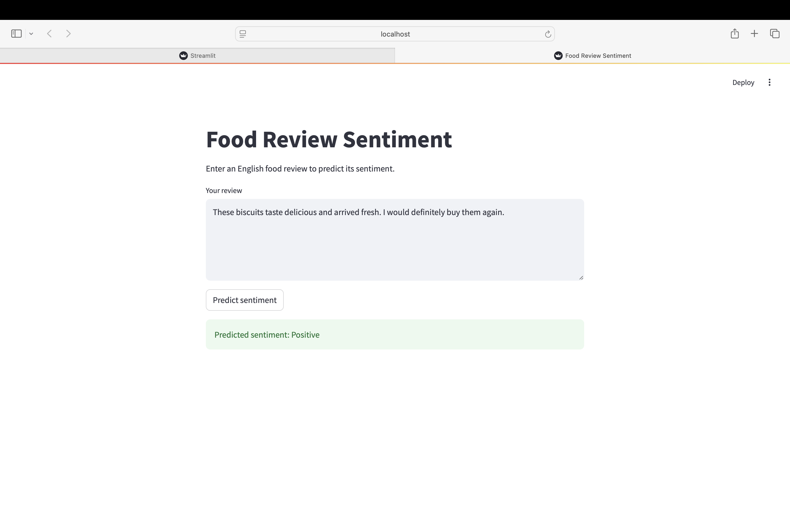
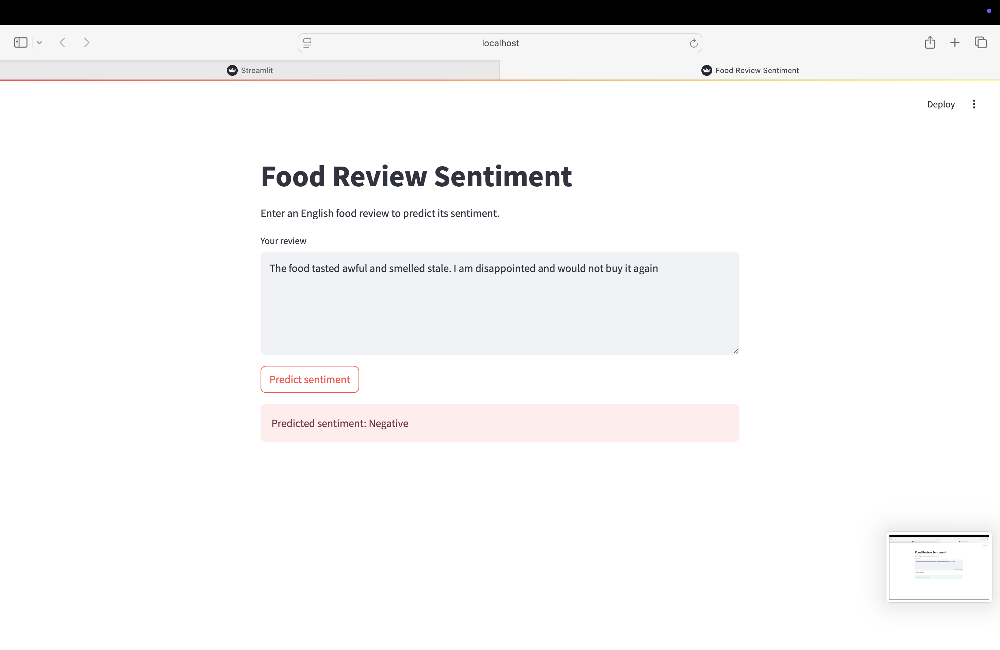
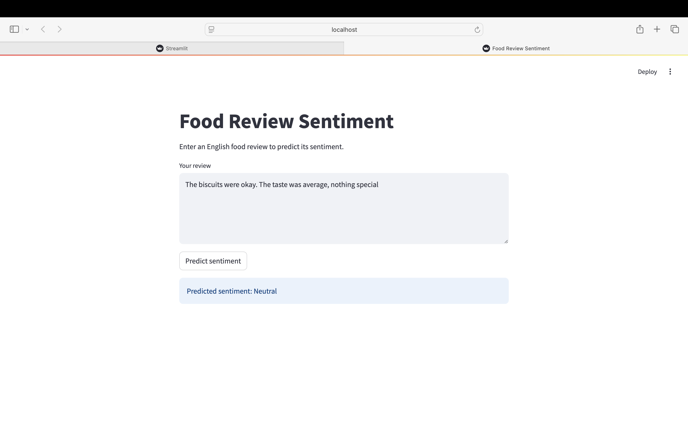

# Food Review Sentiment Analysis-NLP

A machine learning(NLP) project that classifies English food reviews as **Negative**, **Neutral**, or **Positive**, with a Streamlit app for trying predictions.

## Dataset of varun

The project uses Amazon food reviews from `Reviews.csv`. (https://www.kaggle.com/datasets/snap/amazon-fine-food-reviews)

Sentiment labels are derived from star ratings:

- **Negative:** 1–2 stars
- **Neutral:** 3 stars
- **Positive:** 4–5 stars

The experiment uses 900 reviews, balanced across the three classes: 540 for training, 180 for validation, and 180 for testing.

## Approach

- Cleaned HTML tags, converted text to lowercase, and normalized whitespace.
- Compared cleaned, stemmed, and lemmatized text.
- Converted text into numerical features using TF-IDF.
- Compared Logistic Regression, Naive Bayes, and Linear SVM.
- Selected cleaned text with Linear SVM for the prediction app.

## Results

| Test metric | Result |
| ----------- | -----: |
| Accuracy    |    60% |
| Macro F1    |  0.596 |

These results indicate moderate performance on the project's test set.

## Prediction App

The Streamlit app accepts a food review and displays its predicted sentiment.

### Positive prediction


### Negative prediction


### Neutral prediction


## Project Files

- `sentiment_Analysis_NLP.ipynb` — notebook containing the analysis and experiments.
- `app.py` — Streamlit prediction app.
- `sentiment_model.joblib` — saved classifier, TF-IDF vectorizer, and sentiment labels.

## Run the App

Install the required packages:

```bash
python -m pip install streamlit scikit-learn joblib
```

Place `app.py` and `sentiment_model.joblib` in the same folder, then run:

```bash
python -m streamlit run app.py
```

Open the Local URL displayed in the terminal.

## Limitations

- The model was trained on a small sample of food reviews.
- Star ratings are an imperfect proxy for the sentiment expressed in text.
- Short, mixed, or unfamiliar reviews may be classified incorrectly.
- During manual testing, “food is smelling bad” was incorrectly classified as Positive.
- This is a learning project and is not intended for production use.

## What I Learned

This project helped me practise text preprocessing, TF-IDF feature extraction, model comparison, classification evaluation, and building a prediction interface with Streamlit.
